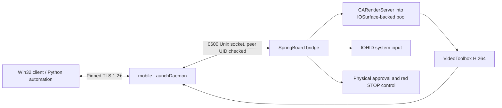

# Implemented architecture

The daemon owns the network listener, authentication, framing, rate limits and
connection recovery. It runs as mobile, not root. The injected library loads
only in SpringBoard and does not hook application methods. It owns capture,
hardware-encoder requests, input state, consent and a 15-minute session lease.
Encoding remains in SpringBoard in this prototype: moving it to the daemon
requires validated IOSurface Mach-right IPC and is a later isolation improvement.
Untrusted network/crypto handling is already outside SpringBoard.

After pinned TLS, the client sends its random 256-bit token and requests viewing
or control. The daemon forwards a consent request to SpringBoard. No video or
input is available until the owner taps Allow physically. A persistent red STOP
control appears on the iPhone; it immediately ends the session. Lock, expiry,
disconnect, respring, timeout or repeated pipeline errors also stop it. Sensitive
text, a HID key press and application launches need another local confirmation;
remote input is disabled while that confirmation is displayed.

Capture renders the native display into a bounded CVPixelBufferPool with
IOSurface backing. It does not treat IOSurface allocation as framebuffer access.
The experimental CARenderServer call is the producer. For reduced resolution,
capture still renders native pixels and Core Image requests GPU scaling into
another bounded pool; the code does not assume a small render target implies
correct scaling. Native mode avoids the scaling stage. Screenshots are explicit
JPEG requests from the current captured frame, not the video transport.

VideoToolbox requests H.264 low-latency rate control, real-time operation, no
frame reordering, expected frame rate and bitrate. Optional properties are
reported accurately: a standard-session fallback is marked lowLatency=false;
hardware use is reported hardware/software/unknown from a dynamically available
runtime property. A reported software encoder is refused. On iOS 16.1 the
newer hardware-requirement specification is unavailable, so unknown remains
unverified rather than being called hardware-confirmed. Every IDR includes SPS
and PPS. CMTime conversion preserves fractional microseconds.

The authenticated client negotiates a bounded window of one to three video
frames; a missing/invalid option selects the legacy one-frame behavior. Current
clients request three slots and the Windows viewer requests 60 FPS by default.
At most two VideoToolbox submissions overlap. Capture skips a tick before
encoding when the window is full; encoded dependent frames are not discarded.
Frame credits acknowledge exact timestamps in FIFO order. Quality changes pause
capture and drain all slots before recreating the pipeline. The capture pool
allows four allocations to cover the two submissions, a retained snapshot and
the next capture target. The native client acknowledges after decoding and
handing pixels to the renderer, not after monitor scanout. The Python client
acknowledges after consuming the encoded frame. TCP handles loss by retransmission;
it can introduce head-of-line delay. A five-second frame acknowledgment timeout
ends stalled sessions. Local IPC writers are bounded and never wait on the
SpringBoard main thread.

GPU-to-CPU frame transfer preserves AVFrame properties explicitly. BGRA conversion
uses the frame's full/limited range and YCbCr matrix, with accurate rounding and
full horizontal chroma interpolation. Untagged legacy video retains FFmpeg's
BT.601 matrix default. Source range is never inferred solely from the downloaded
NV12 pixel format. Encoded grayscale ramps test black and near-white detail;
this SDR path does not implement HDR tone mapping or monitor-profile calibration.

The daemon uses capture-to-client-ack time measured entirely on the iPhone for
a conservative bitrate controller. It samples an EWMA and adjusts no more often
than every three seconds, down by 20% above 80 ms and up by 8% below 35 ms. Bounds
are 500 kbps and the user's ceiling. These are engineering thresholds, not tuned
device measurements. Decode CPU time and RTT are separate client metrics. Real
display latency requires external measurement.

Input uses runtime-resolved IOHID symbols, the sender ID observed from an actual
touchscreen event, per-contact state and all active contacts in a digitizer
report. No device-specific sender constant is assumed. Disconnect releases all
contacts and keys. Gestures and text use timers; no blocking sleeps run on the
SpringBoard thread. The mouse controls one contact; API contacts 0..9 permit
multi-touch. Coordinates are normalized in the natural portrait plane. The
viewer applies inverse rotation and rejects letterbox clicks.

Home and App Switcher use dynamically guarded SpringBoard handlers. Volume
and keyboard remain HID operations. Separate HID clients observe the physical
sender and submit synthetic events; aggregate hand fields are restored after
attaching finger events. Input replies describe submission, with delivery
established separately by inspecting the resulting screen.

The native client uses Win32, OpenSSL and dynamically linked FFmpeg. D3D11VA is
selected when offered; decode failure resets to software and requests an IDR.
Pixels are copied back to BGRA and presented with GDI. This avoids a heavyweight
UI runtime but leaves a CPU/rendering optimization opportunity. The Python
API uses only the standard library and supports persistent JSON-lines RPC. The
optional standard MCP adapter uses the pinned official Python SDK and exposes
screen-image and authorized-input tools over stdio, without a local network port.
The implementation has no required Mac after package installation and pairing.

Modules are separated under ios/capture, encoder, input, common and daemon;
client decoder and connection modules are independent. CI tests production
framing, command validation, certificate pin rejection, H.264 decode and TLS/RPC
behavior. They do not execute iOS private APIs on an iPhone.
