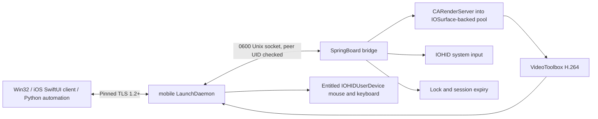

# Implemented architecture

The daemon owns the network listener, authentication, framing, rate limits and
connection recovery. It runs as mobile, not root. The injected library loads
only in SpringBoard and does not hook application methods. It owns capture,
hardware-encoder requests, input state, lock checks and a 15-minute session lease.
Encoding remains in SpringBoard in this prototype: moving it to the daemon
requires validated IOSurface Mach-right IPC and is a later isolation improvement.
Untrusted network/crypto handling is already outside SpringBoard.

After pinned TLS, the client sends its random 256-bit token and requests viewing
or control. The daemon forwards the authenticated session to SpringBoard, which
starts immediately. Clients negotiating lockscreen viewing may connect while
locked; other clients require an unlocked phone. There are no custom connection or
per-action approval dialogs. No floating control button covers the phone screen.
Lock suspends input and native HID, updates an input epoch, and retains negotiated
viewing. Display-off pauses capture; a dedicated backlight-on operation wakes it
without unlocking. Display transitions advertise a timestamp barrier and clear
cached frames. Unlock restores input with the new epoch. Legacy lock, expiry,
disconnect, respring, timeout or repeated pipeline errors stop the session.

F10 uses an entitled IOHIDUserDevice in the mobile daemon. SpringBoard controls
AssistiveTouch and validates every native input request before forwarding it over
local-only IRB_HID messages. Their timestamp field carries the TLS connection
generation; stale-session requests are ignored. Keyboard report 1 carries modifiers
and up to six keys. A separate mouse device uses report 3 for signed X/Y deltas,
buttons and wheel. Foreground Windows WM_INPUT packets provide relative motion;
the viewer sends movement from raw events at up to 125 Hz and sends button edges
immediately. A loopback-only wake byte interrupts the network select wait; all
commands still travel over pinned TLS. Unsent motion is accumulated while button
and wheel events remain ordered. A trailing timer handles the end of a movement.
Viewer rotation transforms movement directions. Focus loss, resize, disconnect
and F10 release capture, queued motion and held input. The final backend registers
no absolute mouse collection: on the target iOS 16.1.1 it did not reliably move
the AssistiveTouch pointer. Native support is runtime checked and failures remain
visible. Original touch automation remains available outside this mode.

Capture renders the native display into a bounded CVPixelBufferPool with
IOSurface backing. It does not treat IOSurface allocation as framebuffer access.
The experimental CARenderServer call is the producer. For reduced resolution,
capture still renders native pixels and Core Image requests GPU scaling into
another bounded pool; the code does not assume a small render target implies
correct scaling. Native mode avoids the scaling stage. Screenshots are explicit
JPEG requests from the current captured frame, not the video transport.

VideoToolbox requests H.264 low-latency rate control, real-time operation, no
frame reordering, expected frame rate and bitrate. Optional properties are
reported accurately: a standard-session fallback is marked lowLatency=false;
hardware use is reported hardware/software/unknown from a dynamically available
runtime property. A reported software encoder is refused. On iOS 16.1 the
newer hardware-requirement specification is unavailable, so unknown remains
unverified rather than being called hardware-confirmed. Every IDR includes SPS
and PPS. CMTime conversion preserves fractional microseconds.

The authenticated client negotiates a bounded window of one to three video
frames; a missing/invalid option selects the legacy one-frame behavior. Current
clients request three slots and the Windows viewer requests 60 FPS by default.
At most two VideoToolbox submissions overlap. Capture skips a tick before
encoding when the window is full; encoded dependent frames are not discarded.
Frame credits acknowledge exact timestamps in FIFO order. Quality changes pause
capture and drain all slots before recreating the pipeline. The capture pool
allows four allocations to cover the two submissions, a retained snapshot and
the next capture target. The native client acknowledges after decoding and
handing pixels to the renderer, not after monitor scanout. The Python client
acknowledges after consuming the encoded frame. TCP handles loss by retransmission;
it can introduce head-of-line delay. A five-second frame acknowledgment timeout
ends stalled sessions. Local IPC writers are bounded and never wait on the
SpringBoard main thread.

GPU-to-CPU frame transfer preserves AVFrame properties explicitly. BGRA conversion
uses the frame's full/limited range and YCbCr matrix, with accurate rounding and
full horizontal chroma interpolation. Untagged legacy video retains FFmpeg's
BT.601 matrix default. Source range is never inferred solely from the downloaded
NV12 pixel format. Encoded grayscale ramps test black and near-white detail;
this SDR path does not implement HDR tone mapping or monitor-profile calibration.

The daemon uses capture-to-client-ack time measured entirely on the iPhone for
a conservative bitrate controller. It samples an EWMA and adjusts no more often
than every three seconds, down by 20% above 80 ms and up by 8% below 35 ms. Bounds
are 500 kbps and the user's ceiling. These are engineering thresholds, not tuned
device measurements. Decode CPU time and RTT are separate client metrics. Real
display latency requires external measurement.

Input uses runtime-resolved IOHID symbols, the sender ID observed from an actual
touchscreen event, per-contact state and all active contacts in a digitizer
report. No device-specific sender constant is assumed. Disconnect releases all
contacts and keys. Gestures and text use timers; no blocking sleeps run on the
SpringBoard thread. The mouse controls one contact; API contacts 0..9 permit
multi-touch. Coordinates are normalized in the natural portrait plane. The
viewer applies inverse rotation and rejects letterbox clicks.

The iOS controller combines SwiftUI with an Objective-C core using public UIKit, Network, Security,
VideoToolbox and AVSampleBufferDisplayLayer APIs. It imports the client pairing
JSON through a scoped document URL and retains the token and exact certificate
pin in a device-only Keychain item. TLS verifies the pin before AUTH. A serial
decoder consumes every encoded access unit, and credits return in timestamp
order after decoded images reach the main-thread renderer. Only decoded
images may be skipped under display backpressure. With VSync enabled, CADisplayLink
submits the latest decoded image at a display opportunity; the renderer retains
at most one pending image and pauses its display link when there is no work.
SwiftUI receives connection state and periodic statistics, not per-frame images.
The floating Home control routes to the same guarded Objective-C operation path.
Touch input tracks up to
two contacts, applies inverse display rotation, and coalesces unsent moves
without crossing contact begin/end boundaries. Backgrounding releases input
and disconnects; network reconnection uses a fresh generation and discards
old input. CI exercises this production path with temporary loopback credentials
and synthetic video; physical controller-device validation is separate.

Home, App Switcher and Control Center use dynamically guarded SpringBoard handlers. Volume
and keyboard remain HID operations. Separate HID clients observe the physical
sender and submit synthetic events; aggregate hand fields are restored after
attaching finger events. Input replies describe submission, with delivery
established separately by inspecting the resulting screen.

The native client uses Win32, OpenSSL and dynamically linked FFmpeg. D3D11VA is
selected when offered; decode failure resets to software and requests an IDR.
Pixels are copied back to BGRA and uploaded to a D3D11 presenter. The Python
API uses only the standard library and supports persistent JSON-lines RPC. The
optional standard MCP adapter uses the pinned official Python SDK and exposes
screen-image and authorized-input tools over stdio, without a local network port.
The implementation has no required Mac after package installation and pairing.

Windows uses a dedicated video child window and a D3D11 flip-model swap chain.
VSync chooses Present interval 1 or 0, with supported tearing flags for interval 0.
Scaling uses bilinear sampling or AMD's FSR 1 EASU for enlargement; optional RCAS
applies the Sharp strength afterward. Shader sources and the unmodified FSR 1
headers are embedded resources. BGRA textures are UNORM without an extra sRGB
decode/encode step. GPU initialization/presentation failure falls back to the
buffered GDI luma-sharpening path and disables advanced options.

The off-by-default SDK 2.4 experiment uses a separate DX12 queue and pinned,
signed AMD loader/upscaler DLLs. It enumerates 4/3/2.3 providers and pins the
requested version, querying the actual selected context for display. Each frame
uses linear float color, a flat depth plane, zero motion, fixed exposure and
history reset. There is no temporal accumulation or frame generation. Explicit
sRGB conversion surrounds the SDK and CPU readback bridges back to D3D11. This
prototype can add significant processing time; unsupported providers fall through
to older versions and then ordinary presentation. The UI reports draw calls per
second separately from the decoder's FPS; neither is physical monitor scanout.

The UI retains an immutable frame without holding the handoff mutex while
painting. Toolbar visibility changes layout and aspect constraints. Input uses
the video child-to-parent transform, inverse rotation and rendered letterbox.
Focused-window shortcuts avoid local edit fields. Live HID down/up input requires
a separate on-phone session grant. Prompts release contacts/keys before taking
focus; later cleanup of an already-released key is a no-op. Focus loss, mode
revocation and disconnect also release held keys.

Modules are separated under ios/capture, encoder, input, common and daemon;
client decoder and connection modules are independent. CI tests production
framing, command validation, certificate pin rejection, H.264 decode and TLS/RPC
behavior. They do not execute iOS private APIs on an iPhone.
